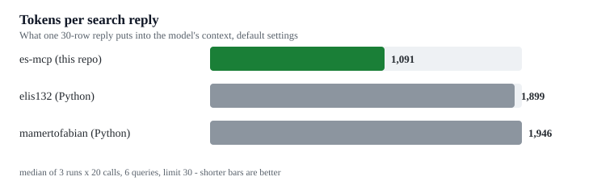
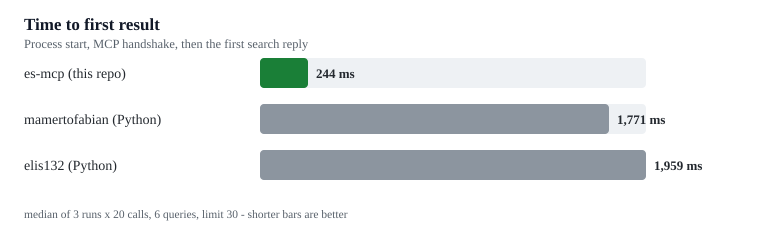

# es-mcp

[](https://github.com/izicoder/es-mcp/actions/workflows/build.yml)
[](LICENSE)
[](https://dotnet.microsoft.com/download)

Instant file search for Windows, built for AI agents.

`es-mcp` is a [Model Context Protocol](https://modelcontextprotocol.io) server (stdio) that exposes the
[voidtools Everything SDK](https://www.voidtools.com/support/everything/sdk/) as tools. Queries run against
Everything's in-memory index, so lookups across millions of files return in milliseconds — no directory
walking, no indexing of your own.

It ships two tools:

| Tool | What it does |
| --- | --- |
| `search_files` | Find files and folders by name, extension, size or date. Full paths, sizes and timestamps. |
| `everything_status` | Say whether Everything is running and how large its index is, before searching. |

## How it compares

<picture>
  <source media="(prefers-color-scheme: dark)" srcset="docs/bench-tokens-dark.svg">
  
</picture>

<picture>
  <source media="(prefers-color-scheme: dark)" srcset="docs/bench-latency-dark.svg">
  
</picture>

Measured on the same machine, same Everything index (1.7M objects), same six queries, limit 30.
`node tools/compare.mjs` reproduces both charts; `tools/bench-results.json` holds the raw numbers.

| | **es-mcp** | [mamertofabian/mcp-everything-search](https://github.com/mamertofabian/mcp-everything-search) | [elis132/everything-mcp](https://github.com/elis132/everything-mcp) |
| --- | --- | --- | --- |
| Language | C# | Python | Python |
| Talks to Everything via | SDK DLL, in-process | SDK DLL, in-process | `es.exe` process per query |
| Runtime to install | .NET 10, or one self-contained `.exe` | Python 3.10+ and `uvx` | Python 3.10+ and `es.exe` |
| Cold start | **141 ms** | 1,726 ms | 1,855 ms |
| Time to first result | **244 ms** | 1,771 ms | 1,959 ms |
| Warm search, p50 | 21 ms | **20 ms** | 131 ms |
| Tokens per 30-row reply | **1,091** | 1,946 | 1,899 |
| Typed results (`structuredContent`) | yes | no | no |

Warm search is a draw with the ctypes server - both call the same SDK in the same process. The
differences that show up in use are startup (about 1.5 seconds per agent session) and reply size.

Measured on an i5-3570, 16 GB RAM, Windows x64, Everything indexing 1.7M objects.

## Install

Open `es-mcp-<version>.mcpb` from [Releases](https://github.com/izicoder/es-mcp/releases/latest) if
your client can install MCP bundles — Claude Desktop can. The bundle carries the server, the .NET
runtime and the SDK DLL, so the app unpacks it and starts it with no config editing.

Every other client wants a path to `es-mcp.exe`, so unzip one of these anywhere:

| Download | Needs | Size |
| --- | --- | --- |
| `es-mcp-win-x64-selfcontained.zip` | nothing else | ~32 MB |
| `es-mcp-win-x64.zip` | .NET 10 runtime | under 1 MB |

The Everything SDK DLL is inside every download, next to the exe, so there is nothing else to fetch.
Each release also publishes `SHA256SUMS.txt`.

Then [register with an MCP client](#register-with-an-mcp-client).

## Requirements

- Windows x64
- [Everything](https://www.voidtools.com/) installed and **running in the background**
- .NET 10 runtime, unless you use the self-contained zip or the `.mcpb` bundle

`Everything64.dll` is loaded from the first of these that exists:

1. `EVERYTHING_SDK_PATH`, set to the DLL or to the folder containing it
2. the folder holding `es-mcp.exe` (the copy bundled with each release)
3. your Everything install folder (e.g. `C:\Program Files\Everything\`)
4. `PATH`

Only the first one needs you to do anything, and only if you want to pin a different SDK build.

## Build

```console
dotnet build
dotnet test
dotnet publish src/EsMcp -c Release -o out/es-mcp
```

`dotnet publish` produces a framework-dependent single-file executable, with `Everything64.dll`
copied from `third_party/` next to it. For a machine without .NET installed, add
`-p:SelfContained=true`.

## Register with an MCP client

If you installed the `.mcpb` bundle, the client is already wired up, so skip to the tool docs.

Otherwise: `dotnet publish` writes `out/es-mcp/es-mcp.exe`. Copy it wherever you keep tools, then point your client at it.
For opencode, in `~/.config/opencode/opencode.json`:

```json
{
  "mcp": {
    "servers": {
      "everything": {
        "type": "local",
        "command": ["C:\\tools\\es-mcp\\es-mcp.exe"]
      }
    }
  }
}
```

For Claude Desktop / Cursor style clients, the same idea: `"command": "C:\\tools\\es-mcp\\es-mcp.exe"`, no arguments.

## `search_files`

| Parameter | Type | Default | Description |
| --- | --- | --- | --- |
| `query` | string | required | Everything query (`*.sln`, `report ext:pdf`, `path:src`, `dm:today`, …) |
| `limit` | integer | 30 | 1-1000 rows; the reply's total count says whether more exist |
| `offset` | integer | 0 | rows to skip, for paging (`offset = nextOffset`) |
| `regex` | boolean | false | query is a regular expression |
| `case_sensitive` | boolean | false | match case |
| `whole_word` | boolean | false | whole words only |
| `match_path` | boolean | false | match the full path, not just the name |
| `sort` | string | `path` | name, path, size, extension, type, date_modified, date_created, date_accessed (+ `_desc`), `none`, or a numeric SDK constant; `sort_by` is an alias |
| `filter` | string | — | extra clause ANDed onto the query, e.g. `ext:cs path:src` |
| `format` | string | `json` | `json` = rows in `structuredContent` + one line summary; `text` = the table only; `full` = adds `name`, `ext`, `created`, `accessed` |

The legacy tool name `search` is still accepted on calls.

### Replies

The default (`format: "json"`) puts the rows in `structuredContent`, which matches the tool's
`outputSchema`, and keeps the text block to one line:

```
20 matches, showing 3; next page offset 3
```

```json
{
  "total": 20,
  "returned": 3,
  "offset": 0,
  "hasMore": true,
  "nextOffset": 3,
  "results": [
    { "path": "E:\\src\\api\\README.md", "size": 1234, "modified": "2026-02-03 09:14" },
    { "path": "E:\\src\\api\\docs", "folder": true, "modified": "2026-01-30 17:42" }
  ]
}
```

Four fields per row, on purpose: `name` and `ext` are already inside `path`, `created` and `accessed`
are rarely what a search is for, and folders carry no `size` because Everything does not report one.
That is 65% fewer tokens than the 2.0.0 payload for the same result set, and about half of what the
other Everything MCP servers send for the same 30 rows.

Ask for more only when you need it:

- `format: "full"` - adds `name`, `ext`, `created` and `accessed`, with ISO 8601 timestamps.
- `format: "text"` - the table below and no `structuredContent`, for clients that never read it.

```
20 total, showing 3
    1.2 MB  2026-02-03  C:\src\api\README.md
    4.4 KB  2026-02-03  C:\src\api\docs\README.md
   <dir>    2026-01-30  C:\src\api\docs
... 17 more of 20 total (page with offset 3, raise limit, or narrow the query)
```

A query that matches nothing says exactly that, and says what to change:

```
No files or folders match "quarterly_report_final.csv" - nothing was found for this query.
Try a different query:
- a shorter fragment or wildcard: 'report*' instead of one exact file name
- drop narrowing terms: ext:, path:, dm: and size: are ANDed, so each one removes results
- search full paths: match_path=true, or wrap the fragment in path: like 'path:src\api'
- broaden dates or sizes: 'dm:thisyear' instead of 'dm:today', 'size:>1mb' instead of 'size:>1gb'
```

## `everything_status`

No parameters. Returns whether the SDK loaded, whether Everything is running, the indexed object count,
the Everything version and the DLL path.

```json
{
  "ready": true,
  "sdkLoaded": true,
  "databaseLoaded": true,
  "version": "1.4.1.1026",
  "sdkPath": "C:\\Program Files\\Everything\\Everything64.dll",
  "totalCount": 1845267,
  "error": null
}
```

When `ready` is `false`, the call is marked `isError` and `error` says what to fix. That makes it a cheap
precheck: an agent can call it once instead of discovering a dead Everything through a failed search.

## What the agent sees

The server is written to be usable without prior knowledge and without reading this README:

- **Tool names say what they do.** `search_files`, not `search`, so it wins over web-search tools in a tool list.
- **The description front-loads the decision**: use it *instead of* `dir`, `Get-ChildItem`, `where.exe` or `glob`,
  plus the query cheatsheet inline.
- **`initialize` returns `instructions`** — a short cheatsheet (query syntax, reply format, paging, error meaning)
  that clients inject into the model's context.
- **Annotations** mark both tools `readOnlyHint`, `idempotentHint`, `openWorldHint: false`, so agents know they are
  safe, local, repeatable reads.
- **Schemas carry the details**: 1-1000 limit range, `enum` of sort orders, `examples` for common calls, and output
  schemas so structured results are self-describing.
- **Empty and out-of-range results are self-correcting**: they name the failure and list concrete alternatives
  (broader fragment, drop `path:`/`ext:` terms, `match_path`, wider dates).
- **Protocol version negotiation**: the server echoes the client's version when it supports it (2024-11-05 through
  2025-11-25) and otherwise replies with its newest.
- **stdout stays protocol-clean**; diagnostics are written to stderr.

Agent-side, this replaces `dir`, `Get-ChildItem` and `where.exe`: one call answers "where is this file", "what is
the biggest thing on this drive", "list every `.sln` under `E:\work`".

## Layout

```
src/EsSdk/            Everything SDK interop (native bindings, DLL resolution, search and status API)
src/EsMcp/            MCP stdio server (protocol loop, tool catalog, argument parsing, result formatting)
tests/EsMcp.Tests/    xunit tests for the protocol, schemas, argument handling and result messages
third_party/          the bundled Everything64.dll and its notice
tools/bench.mjs       round-trip latency against a published es-mcp.exe
tools/compare.mjs     the same, head to head with other MCP file-search servers, plus payload size
tools/charts.mjs      turns bench-results.json into the two SVGs in docs/
tools/winget-manifest.ps1  builds the three winget manifests for a published release
tools/mcpb.ps1        builds the Claude Desktop bundle from a self-contained publish
docs/                 generated charts, plus bench-summary.json
```

`EsSdk` owns the only `DllImport` surface and one error model; `EsMcp` owns the protocol.

## Benchmark

Publish first, then run the scripts with Node:

```console
dotnet publish src/EsMcp -c Release -o out/es-mcp
node tools/bench.mjs out/es-mcp/es-mcp.exe 20          # this server alone
node tools/compare.mjs --save tools/bench-results.json # head to head, writes the raw numbers
node tools/charts.mjs                                  # regenerates docs/*.svg
```

`compare.mjs` starts each server over stdio, measures cold start, time to first result and warm
p50/p95, then measures the payload each reply puts into a model's context. It skips any server whose
executable is missing, so you need `es.exe` on hand (for the es.exe based servers) and
`EVERYTHING_SDK_PATH` set (for the SDK based ones). Point it at other servers by adding an entry to
`SERVERS` in the script; the query set and limits are shared, which is the only way the numbers mean
anything.

## Notes and limits

- Everything must be running; the SDK talks to it over its IPC channel.
- The SDK keeps process-wide state, so `Everything.Search` and `Everything.GetStatus` serialize their calls.
- Folder results report no recursive size — treat their `size` as meaningless rather than as disk usage.
- `date_created` / `date_accessed` need those properties enabled in Everything's options to be meaningful.
- `everything_status` derives `totalCount` from a one-row `*` query, because the SDK only reports counts for the
  last query.

## License

[MIT](LICENSE) — the Everything SDK itself is © voidtools and distributed with Everything under its own terms.
